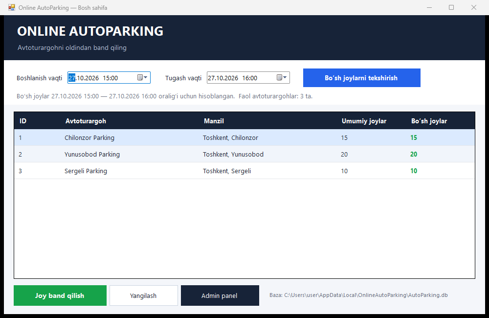
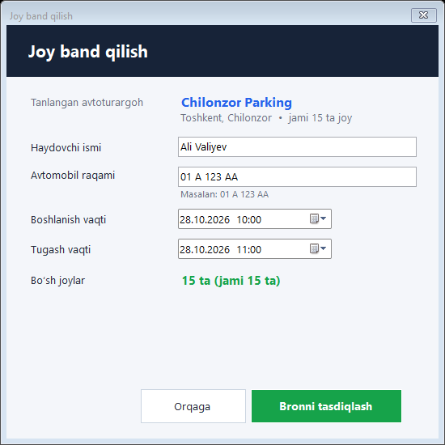
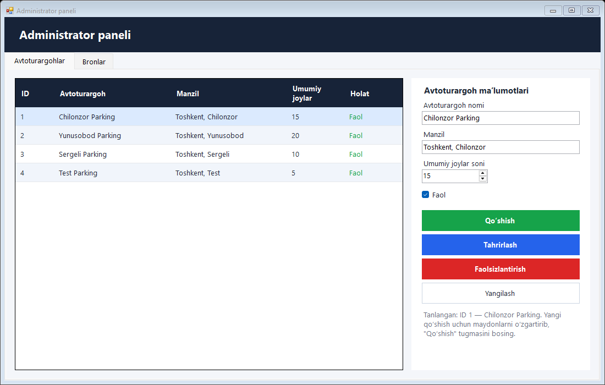
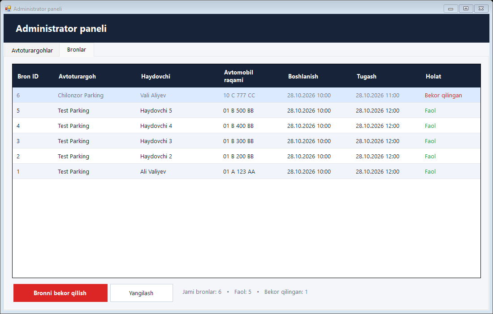

# Online AutoParking

Haydovchilar avtoturargohga yetib kelishdan oldin tanlangan joyda va vaqtda joy band qilishi mumkin bo‘lgan Windows desktop ilova. Ilova universitet loyihasi uchun yozilgan. U onlayn bron qilish tizimining **lokal prototipi**: internet, server va API ishlatilmaydi, barcha ma’lumotlar bitta SQLite faylida saqlanadi.

| | |
|---|---|
| Til | C# 7.3 |
| Interfeys | Windows Forms (WinForms) |
| Platforma | .NET Framework 4.8 |
| Ma’lumotlar bazasi | SQLite (`parking.db`) |
| SQLite provayderi | Microsoft.Data.Sqlite 8.0.10 (NuGet) |
| IDE | Visual Studio 2022 |
| OT | Windows 10 / Windows 11 |
| Oynalar | 3 ta: MainForm, BookingForm, AdminForm |
| Jadvallar | 2 ta: ParkingLots, Bookings |



---

## 1. O‘rnatish va ishga tushirish

### Talablar

- Windows 10 yoki Windows 11
- **Visual Studio 2022** (Community versiyasi ham bo‘ladi), **“.NET desktop development”** workload bilan
- Birinchi build uchun internet (NuGet paketlarini yuklab olish uchun)

### Qadamlar (Visual Studio 2022)

1. Loyiha papkasini **qisqa yo‘lga** qo‘ying, masalan `C:\Projects\OnlineAutoParking`.
   > ⚠️ .NET Framework juda uzun yo‘ldagi (~240 belgidan uzun) `.exe` ni ishga tushira olmaydi. Bunda `CLR error: 8007007a` xatosi chiqadi.
2. `OnlineAutoParking.sln` faylini Visual Studio 2022 da oching.
3. Visual Studio NuGet paketlarini o‘zi tiklaydi. Agar tiklamasa, **Solution Explorer → Solution ustida o‘ng tugma → Restore NuGet Packages** ni tanlang.
4. Yuqoridagi konfiguratsiya **Debug** va **Any CPU** bo‘lsin.
5. **F5** (yoki *Debug → Start Debugging*) ni bosing.
6. Ilova `PBL2_AutoParking\parking.db` bazasini topib ishlatadi. Fayl topilmasa, `.exe` yonida yangi `parking.db` yaratiladi va unga 3 ta namunaviy avtoturargoh qo‘shiladi.

### Buyruq satri orqali (ixtiyoriy)

.NET SDK 6/7/8 o‘rnatilgan bo‘lsa:

```bash
dotnet build OnlineAutoParking.sln -c Release
```

Tayyor dastur: `OnlineAutoParking\bin\Release\net48\OnlineAutoParking.exe`. `bin\Release\net48` papkasini to‘liq nusxalang, chunki ilovaga `runtimes\win-x64\native\e_sqlite3.dll` ham kerak.

### NuGet paketlari

`OnlineAutoParking.csproj` ichida e’lon qilingan:

| Paket | Versiya | Vazifasi |
|---|---|---|
| `Microsoft.Data.Sqlite` | 8.0.10 | SQLite bilan ishlash. `e_sqlite3.dll` native kutubxonasini ham o‘zi olib keladi |
| `Microsoft.NETFramework.ReferenceAssemblies` | 1.0.3 | .NET 4.8 targeting pack o‘rnatilmagan kompyuterda ham build qilish uchun (faqat build vaqtida kerak) |

---

## 2. Ma’lumotlar bazasi qayerda?

```
PBL2_AutoParking\parking.db
```

- Ilova `.exe` turgan papkadan boshlab yuqoriga qarab birinchi topilgan `parking.db` faylini ishlatadi (`DatabaseHelper.FindDatabasePath`). Ishlab chiqish paytida bu loyiha papkasidagi `PBL2_AutoParking\parking.db` bo‘ladi.
- Hech qayerda topilmasa, `.exe` yonida yangi `parking.db` yaratiladi. Dasturni boshqa kompyuterga berganda `parking.db` ni `.exe` yoniga qo‘yish kifoya.
- To‘liq yo‘l bosh sahifaning pastki o‘ng burchagida ko‘rsatiladi.
- Dastur mavjud bazani hech qachon o‘chirmaydi va qayta yozmaydi.
- **Bazani noldan boshlash uchun:** dasturni yoping va `parking.db` faylini o‘chiring. Keyingi ishga tushishda `.exe` yonida yangi baza yaratiladi.

### DB Browser for SQLite bilan ochish

1. https://sqlitebrowser.org dan **DB Browser for SQLite** ni yuklab oling va o‘rnating.
2. Dasturni oching → **Open Database** (Ctrl+O).
3. `PBL2_AutoParking` papkasiga o‘ting va `parking.db` ni tanlang.
4. **Browse Data** yorlig‘ida `ParkingLots` va `Bookings` jadvallarini tanlab, yozuvlarni ko‘ring.
5. **Execute SQL** yorlig‘ida `DatabaseSchema.sql` oxiridagi tayyor so‘rovlarni ishlatib ko‘ring.
6. ⚠️ Ilova ishlayotgan paytda DB Browser’da o‘zgartirish kiritsangiz, **Write Changes** (Ctrl+S) ni bosing yoki DB Browser’ni yoping. Aks holda baza qulflanib qoladi va ilova yozolmaydi.

> Vaqtlar bazada **UTC** formatida saqlanadi: `2026-10-28T05:00:00.0000000Z`. Toshkent vaqti UTC+5, shuning uchun bu yozuv ilovada `28.10.2026 10:00` bo‘lib ko‘rinadi.

---

## 3. Loyiha tuzilmasi

```
OnlineAutoParking/
├── OnlineAutoParking.sln
├── README.md
├── DatabaseSchema.sql            — SQL sxema va namunaviy so‘rovlar
├── docs/                         — ekran rasmlari
└── OnlineAutoParking/
    ├── OnlineAutoParking.csproj  — SDK-style, net48, NuGet paketlari
    ├── app.manifest              — Windows 10/11, DPI sozlamasi
    ├── Program.cs                — kirish nuqtasi, bazani initsializatsiya qilish
    ├── MainForm.cs / .Designer.cs
    ├── BookingForm.cs / .Designer.cs
    ├── AdminForm.cs / .Designer.cs
    ├── DatabaseHelper.cs         — baza yo‘li, ulanish, jadvallar, seed, vaqt konvertatsiyasi
    ├── ParkingRepository.cs      — ParkingLots CRUD, bo‘sh joylar, sig‘im tekshiruvi
    ├── BookingRepository.cs      — bron yaratish (tranzaksiya), ro‘yxat, bekor qilish
    ├── UiTheme.cs                — umumiy ranglar va DataGridView uslubi
    └── Models/
        ├── ParkingLot.cs
        └── Booking.cs
```

Formalar standart WinForms designer usulida yozilgan (`partial class` + `InitializeComponent`), shuning uchun ularni Visual Studio Designer’da ochib tahrirlash mumkin.

---

## 4. Oynalar

### MainForm — “Online AutoParking — Bosh sahifa”

- Ochilganda SQLite’dan **faqat faol** avtoturargohlar `SELECT` qilinadi.
- Standart vaqt oralig‘i: **keyingi to‘liq soatdan boshlab 1 soat** (masalan, hozir 14:23 bo‘lsa, 15:00–16:00).
- **“Bo‘sh joylarni tekshirish”** tugmasi har bir avtoturargoh uchun tanlangan oraliqdagi bo‘sh joylarni qayta hisoblaydi. Bo‘sh joy bo‘lsa son yashil, bo‘lmasa qizil rangda chiqadi.
- **“Joy band qilish”** tugmasi (yoki qatorga ikki marta bosish) avval avtoturargoh tanlanganini va bo‘sh joy borligini bazadan qayta tekshiradi, keyin BookingForm’ni ochadi. Unga `ParkingLotID` va vaqt oralig‘i uzatiladi.
- **“Yangilash”** jadvalni bazadan qayta o‘qiydi. **“Admin panel”** AdminForm’ni ochadi.
- Ikkala oyna ham modal (`ShowDialog`) ochiladi, shuning uchun bir vaqtda faqat bittasi ochiq bo‘ladi. Oyna yopilgach jadval avtomatik yangilanadi.

### CarsForm — “Mening mashinalarim”

- MainForm’dagi **“Mening mashinalarim”** tugmasi orqali ochiladi. Har bir foydalanuvchi faqat o‘z mashinalarini ko‘radi va boshqaradi; bir foydalanuvchida bir nechta mashina bo‘lishi mumkin.
- **Qo‘shish:** raqam (majburiy) va nom/model (ixtiyoriy). Raqam formati avvalgidek tekshiriladi (`## A###AA` yoki `## ###AAA`), katta harfga o‘tkaziladi va yagona ko‘rinishga keltiriladi (`01 A123BC`). Bitta raqamni bazada faqat bitta foydalanuvchi ro‘yxatdan o‘tkaza oladi.
- **O‘chirish:** tugamagan faol broni bor mashinani o‘chirib bo‘lmaydi. Eski bronlar tarixda qoladi (raqam bronning o‘zida ham saqlanadi).
- Ma’lumotlar bazada `Cars` jadvalida, `Bookings.CarID` esa bron qaysi mashina bilan qilinganini bildiradi. Eski bronlarda `CarID` bo‘sh (NULL) bo‘ladi.

### BookingForm — “Joy band qilish”



- Tanlangan avtoturargoh nomi, manzili va sig‘imi ko‘rsatiladi.
- Vaqt o‘zgartirilganda bo‘sh joylar soni darhol qayta hisoblanadi.
- **Mashina tanlash:** raqam endi qo‘lda yozilmaydi — foydalanuvchi o‘z mashinalari ro‘yxatidan tanlaydi. Bitta mashina bo‘lsa u avtomatik tanlanadi, ikki va undan ko‘p bo‘lsa foydalanuvchi o‘zi tanlashi shart. Mashina yo‘q bo‘lsa, avval mashina qo‘shish taklif qilinadi.
- **Tekshiruvlar:** ism bo‘sh emas; mashina tanlangan; boshlanish vaqti o‘tib ketmagan; tugash vaqti boshlanishdan keyin; avtoturargoh mavjud va faol; bo‘sh joy > 0.
- **“Bronni tasdiqlash”** bosilganda `BookingRepository.CreateBooking` ishga tushadi (5-bo‘limga qarang). Muvaffaqiyatli bo‘lsa:
  `Joy muvaffaqiyatli band qilindi!  Bron raqami: N`
  Joy qolmagan bo‘lsa: `Uzr, tanlangan vaqt uchun bo‘sh joy mavjud emas.`

### AdminForm — “Administrator paneli” (bitta oynada 2 ta yorliq)

**A. Avtoturargohlar** — barcha avtoturargohlar, faol bo‘lmaganlari ham:



| Tugma | Nima qiladi |
|---|---|
| Qo‘shish | `INSERT INTO ParkingLots`. Nom va manzil bo‘sh bo‘lmasligi, joylar soni > 0 bo‘lishi tekshiriladi |
| Tahrirlash | Tanlangan qatorni `UPDATE` qiladi, ID o‘zgarmaydi. Sig‘imni bir vaqtda mavjud faol bronlar sonidan kamaytirishga **ruxsat berilmaydi** |
| Faolsizlantirish | `IsActive = 0`. Yozuv o‘chirilmaydi, eski bronlar ko‘rinib turadi, yangi bron qilib bo‘lmaydi |
| Yangilash | Jadvalni qayta o‘qiydi |

**B. Bronlar** — `Bookings JOIN ParkingLots` natijasi:



- **“Bronni bekor qilish”** tasdiqlash oynasidan keyin quyidagi so‘rovni bajaradi:
  `UPDATE Bookings SET Status = 'Cancelled' WHERE BookingID = @BookingID AND Status = 'Active';`
  Yozuv **o‘chirilmaydi**. Bekor qilingan bronlar kulrang ko‘rinadi va endi joy egallamaydi.

---

## 5. Asosiy mantiq

### Bo‘sh joylar algoritmi

Ikki vaqt oralig‘i kesishadi, agar:

```
mavjud.StartTime < so‘ralgan.EndTime  VA  mavjud.EndTime > so‘ralgan.StartTime
```

```sql
SELECT COUNT(*)
FROM Bookings
WHERE ParkingLotID = @ParkingLotID
  AND Status = 'Active'
  AND StartTime < @RequestedEnd
  AND EndTime > @RequestedStart;
```

`Bo‘sh joylar = TotalSpaces − kesishgan faol bronlar`. Natija hech qachon manfiy ko‘rsatilmaydi.

- Bekor qilingan bronlar sanalmaydi.
- 10:00–12:00 va 12:00–13:00 kesishmaydi (biri tugaganda ikkinchisi boshlanadi).
- Bazada alohida `AvailableSpaces` ustuni **yo‘q**. Bo‘sh joylar har safar bronlardan qayta hisoblanadi, shuning uchun qiymat hech qachon eskirib qolmaydi.

Misol: sig‘im 3, bronlar 10:00–12:00 va 11:00–13:00. So‘rov 11:30–12:30 bo‘lsa, 2 ta joy band, **1 ta bo‘sh**.

### Parallel bronlardan himoya (oxirgi joy muammosi)

`CreateBooking` bitta ulanish va bitta tranzaksiya ichida quyidagilarni bajaradi:

1. `BEGIN IMMEDIATE` — yozish qulfi **tranzaksiya boshidayoq** olinadi (`connection.BeginTransaction(deferred: false)`).
2. Avtoturargoh mavjudligi va `IsActive` qayta tekshiriladi.
3. Kesishgan faol bronlar **shu tranzaksiya ichida** sanaladi.
4. Joy bo‘lsa `INSERT` qilinadi va `last_insert_rowid()` olinadi.
5. `COMMIT`. Xatolik bo‘lsa `ROLLBACK`.

SQLite’da bir vaqtda faqat bitta yozuvchi ishlay oladi. Ikkinchi so‘rov birinchisi `COMMIT` qilguncha kutadi (`busy_timeout` = 10 s), so‘ng yangilangan sonni ko‘rib, “joy yo‘q” javobini oladi. Oddiy (deferred) `BEGIN` yetarli emas: unda ikkala so‘rov ham bir vaqtda “1 ta joy bor” deb o‘qib qo‘yishi mumkin edi. MainForm’da ko‘rsatilgan son faqat ma’lumot uchun. Yakuniy qaror shu tranzaksiya ichida qabul qilinadi.

### Sig‘imni kamaytirish (Tahrirlash)

`ParkingRepository.GetMaxSimultaneousBookings` **sweep line** algoritmidan foydalanadi. Hali tugamagan har bir faol bron uchun “boshlanish +1” va “tugash −1” hodisalari yaratiladi. Hodisalar vaqt bo‘yicha saralanadi (bir vaqtda bo‘lsa avval tugash, keyin boshlanish), so‘ng yig‘indining maksimumi topiladi. Yangi sig‘im shu maksimumdan kichik bo‘lsa, o‘zgarish rad etiladi va minimal ruxsat etilgan qiymat ko‘rsatiladi. Tekshiruv va `UPDATE` ham bitta `BEGIN IMMEDIATE` tranzaksiyasida bajariladi.

### Vaqtni saqlash

- `DateTimePicker` mahalliy vaqtda ishlaydi.
- Bazaga yozishdan oldin vaqt UTC ga o‘tkaziladi va doim bir xil uzunlikdagi formatda saqlanadi: `yyyy-MM-ddTHH:mm:ss.fffffffZ`. Shu sababli SQL’dagi `<` va `>` satr solishtiruvi to‘g‘ri ishlaydi.
- Ekranga chiqarishda vaqt yana mahalliy vaqtga aylantiriladi.

### Birinchi initsializatsiya

`DatabaseHelper.Initialize()` bitta tranzaksiyada jadvallar va indeksni (`IF NOT EXISTS`) yaratadi. `PRAGMA user_version` 0 bo‘lsa (baza yangi bo‘lsa), 3 ta namunaviy avtoturargoh qo‘shiladi va `user_version = 1` belgisi qo‘yiladi. Shu sababli namunaviy ma’lumotlar qayta qo‘shilmaydi, hatto admin barcha avtoturargohlarni o‘chirib yuborgan bo‘lsa ham.

### Xavfsizlik

- Barcha SQL so‘rovlar **parametrli** (`@ParkingLotID`, `@DriverName`, …). Bu SQL injection’dan himoya qiladi.
- Har bir ulanishda `PRAGMA foreign_keys = ON` yoqiladi.
- Ulanishlar, buyruqlar, reader’lar va tranzaksiyalar `using` bloklari ichida yopiladi.

---

## 6. Sinov holatlari (qo‘lda tekshirish)

| # | Qadamlar | Kutilgan natija |
|---|---|---|
| 1 | `parking.db` yo‘q holatda dasturni ishga tushiring | Baza va 2 ta jadval yaratiladi, 3 ta avtoturargoh ko‘rinadi |
| 2 | Admin panel → nom `Test Parking`, manzil `Toshkent, Test`, joylar `5` → Qo‘shish | Yangi qator paydo bo‘ladi, admin panel yopilgach MainForm’da ham ko‘rinadi |
| 3 | `Test Parking` ni tanlang → Joy band qilish → `Ali Valiyev`, `01 A 123 AA` → Bronni tasdiqlash | “Joy muvaffaqiyatli band qilindi! Bron raqami: N”, Admin → Bronlar’da Status = Faol |
| 4 | Xuddi shu vaqtga yana 4 ta bron qiling (jami 5), keyin 6-sini urinib ko‘ring | 6-bron rad etiladi: “Uzr, tanlangan vaqt uchun bo‘sh joy mavjud emas.” Bazada 6-yozuv yo‘q |
| 5 | Boshlanish vaqtini oldingi bronlar tugagan vaqtga qo‘yib bron qiling | Bron muvaffaqiyatli |
| 6 | Admin → Bronlar → bronni tanlang → Bronni bekor qilish → Ha | Status “Bekor qilingan”, MainForm’da bo‘sh joy +1 |
| 7 | Dasturni yopib qayta oching | Avtoturargohlar va bronlar saqlangan, baza qayta yaratilmagan |
| 8 | Bo‘sh ism / bo‘sh raqam / o‘tgan vaqt / tugash < boshlanish bilan urinib ko‘ring | Har biri uchun ogohlantirish chiqadi, bazaga yozilmaydi |
| 9 | 5 ta bron bor `Test Parking` sig‘imini 3 ga o‘zgartirib Tahrirlash | Rad etiladi: “Ruxsat etilgan minimal sig‘im: 5” |
| 10 | `OnlineAutoParking.exe` ni **ikki marta** ishga tushiring. Ikkala oynada ham 1 ta bo‘sh joy qolgan avtoturargoh uchun BookingForm’ni oching va ketma-ket “Bronni tasdiqlash” ni bosing | Faqat birinchisi muvaffaqiyatli, ikkinchisiga “bo‘sh joy mavjud emas” chiqadi |

**Avtomatik tekshirilgan:** 1–10 holatlar ma’lumotlar qatlami darajasida (repository’lar va haqiqiy SQLite fayli bilan) avtomatlashtirilgan test bilan ishga tushirildi va 36 ta tekshiruvdan 36 tasi o‘tdi. 10-holat uchun 8 ta oqim bir vaqtda (`Barrier` yordamida) oxirgi joyni band qilishga uringan. 25 marta takrorlanganda har safar aynan bittasi muvaffaqiyatli bo‘ldi va sig‘im hech qachon oshib ketmadi. Formalardagi tekshiruv xabarlari (8-holat) qo‘lda tekshirish uchun qoldirilgan.

---

## 7. Universitet taqdimoti uchun reja (~7 daqiqa)

1. **Kirish (30 s).** Muammo: haydovchi avtoturargohga borguncha joy bo‘lishini bilmaydi. Yechim: joyni oldindan band qilish.
2. **Arxitektura (1 daq).** 3 ta oyna → repository’lar → SQLite. Ikki jadval, tashqi kalit, `CHECK` cheklovlari. `DatabaseSchema.sql` ni ko‘rsating.
3. **Birinchi ishga tushish (30 s).** `parking.db` ni o‘chirib, dasturni oching. Baza yaratiladi, 3 ta avtoturargoh ko‘rinadi. Fayl yo‘li pastki o‘ng burchakda.
4. **Bron qilish (1,5 daq).** Vaqtni tanlang → “Bo‘sh joylarni tekshirish” → Chilonzor → “Joy band qilish” → ma’lumotlarni kiriting → bron raqami chiqadi. Bo‘sh joylar 15 → 14 ga tushadi. Vaqtni boshqa oraliqqa o‘zgartirib, yana 15 bo‘lishini ko‘rsating (vaqtga bog‘liq algoritm).
5. **To‘liq sig‘im (1 daq).** Admin’da 2 joyli avtoturargoh qo‘shing, 2 ta bron qiling, 3-si rad etiladi.
6. **Admin (1 daq).** Bronni bekor qiling → joy bo‘shaydi. Sig‘imni kamaytirishga urinib ko‘ring → rad etiladi. Avtoturargohni faolsizlantiring → bosh sahifadan yo‘qoladi, bronlar tarixda qoladi.
7. **Bazani ko‘rsatish (1 daq).** DB Browser for SQLite’da `Bookings` jadvalini oching: UTC vaqtlar, `Status = 'Cancelled'` yozuvlar o‘chirilmagan. `JOIN` so‘rovini ishga tushiring.
8. **Xulosa (30 s).** Parametrli so‘rovlar, `BEGIN IMMEDIATE` tranzaksiya (oxirgi joy muammosi), ma’lumotlar qayta ishga tushirilgandan keyin ham saqlanadi.

---

## 8. Muammolarni hal qilish

| Belgisi | Sababi / yechimi |
|---|---|
| `CLR error: 8007007a` va dastur darhol yopiladi | Loyiha juda uzun yo‘lda turibdi. Uni `C:\Projects\...` ga ko‘chiring |
| `Library e_sqlite3 not found` | `bin\...\net48\runtimes\` papkasi nusxalanmagan yoki platforma `x86` qilib qo‘yilgan. **Any CPU** bilan qayta build qiling va papkani to‘liq nusxalang |
| `database is locked` | Bazani DB Browser’da ochib, o‘zgarishlarni saqlamagansiz. **Write Changes** ni bosing yoki DB Browser’ni yoping |
| NuGet paketlari tiklanmayapti | Internetni tekshiring. *Tools → Options → NuGet Package Manager → Package Sources* da `nuget.org` yoqilgan bo‘lsin |
| Bazani noldan boshlash kerak | Dasturni yoping, `PBL2_AutoParking\parking.db` ni o‘chiring |
